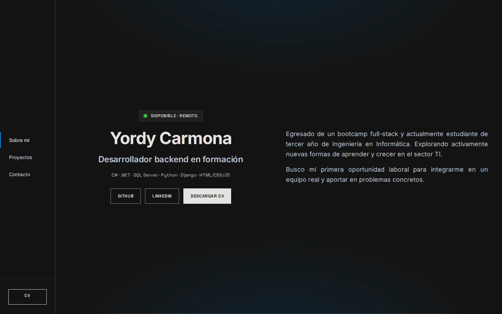

# yordycg-portfolio

Personal portfolio built with a "Vanilla Web" stack.

[Live site](https://yordycg.github.io/yordycg-portfolio/) ·
[Desktop screenshot](docs/screenshots/home-desktop.webp) ·
[Mobile screenshot](docs/screenshots/home-mobile.webp)



## Philosophy

- **Minimalist:** Only what is necessary.
- **Performant:** Lightning-fast load times.
- **Framework-free:** Pure HTML, CSS and JavaScript.
- **No runtime dependencies:** npm is used only for development tooling. The
  deployed site is the `src/` directory, served as-is.
- **Accessible:** keyboard navigation, visible focus, skip link and WCAG AA
  contrast.
- **Reproducible:** pinned Node/npm tooling, CI checks and a locked manifest.

## Tech Stack

- **HTML5 / CSS3 / ES Modules**
- **Node.js 22 + npm** (tooling only)
- **Biome** (linting and formatting)
- **Just** (command runner)
- **Podman + Nginx unprivileged** (local production serving)

## Structure

```text
src/                  published site
  index.html
  404.html
  css/main.css
  js/app.js
  assets/             fonts, images, favicon, CV
docs/                 content, CV source, screenshots and guides
scripts/              dev server, CV, screenshots, OG and QA
.github/              CI, deploy and Dependabot
nginx.conf            security headers and 404 handling
lighthouserc.json     Lighthouse CI thresholds
```

## Getting Started

### Prerequisites

- Node.js 22
- [Just](https://github.com/casey/just)
- [Podman](https://podman.io/) + `podman-compose` (for `just prod`)

### Development

```bash
npm install
just dev
```

Open the URL printed in the terminal (default `http://localhost:3000`).

### Production (local)

```bash
just prod
```

Open `http://localhost:8080`. The container uses `nginx-unprivileged` and serves
the built `src/` directory on port 8080.

## Scripts

| Command | Description |
|---|---|
| `just dev` / `npm run dev` | Browsersync with auto-reload |
| `just prod` | Podman + Nginx locally |
| `npm run check` | Biome lint + format check + HTML validation |
| `npm run format` | Format CSS/JS/JSON with Biome |
| `npm run links` | Internal link checker |
| `npm run a11y` | axe on index and 404 |
| `npm run lighthouse` | Lighthouse CI |
| `npm run cv` | Regenerate the CV PDF |
| `npm run screenshots` | Regenerate README screenshots |
| `npm run og` | Regenerate the Open Graph image |
| `npm run audit:runtime` | Verify there are no runtime dependencies |

`npm run a11y` and `npm run lighthouse` need Chromium/Chrome. In CI they run
through Playwright Chromium.

## CV

The editable source is `docs/cv/index.html` and `docs/cv/cv.css`. The published
PDF is generated with:

```bash
npm run cv
```

The CV is single-column, ATS-friendly, one A4 page, uses standard TrueType
fonts and has no photo, tables or icons. See `docs/cv/README.md` for editing
rules and validation.

## Documentation

- `docs/content.md` — site copy source of truth
- `docs/profile-consistency.md` — what appears on the site, CV and LinkedIn
- `docs/linkedin.md` — profile copy and step-by-step update guide
- `docs/domain-migration.md` — future custom domain checklist
- `docs/mockup/DESIGN.md` — design system

## Deployment

GitHub Pages deploys only `src/`. `package.json`, `node_modules/`, scripts,
docs and tests never reach the published site.
